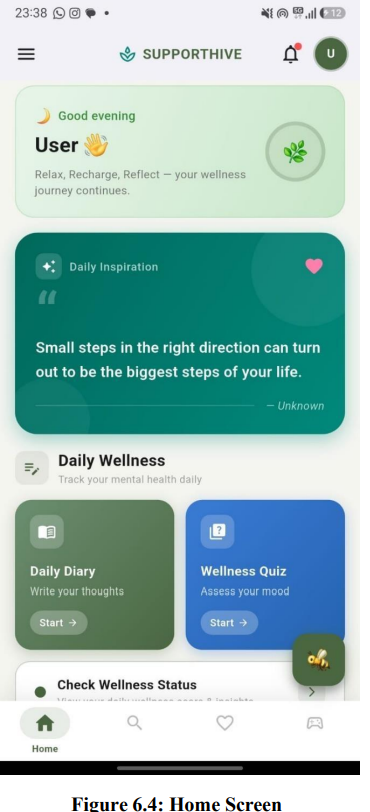

# supportHive
# SupportHive – Student Stress Management Platform

SupportHive is a mobile application designed to support students' mental well-being by providing stress-management resources, interactive activities, and access to support services. The project aims to make mental wellness resources more accessible through a user-friendly mobile experience.

## Features

- **Stress Management:** Tools and activities to help students manage everyday stress.
- **AI Chat Support:** A chat interface for support-related interactions.
- **Counselling and Expert Support:** Screens and services for counselling and expert-related features.
- **Interactive Games:** Activities designed to encourage relaxation, focus, and engagement.
- **Booking Management:** Features related to scheduling and managing support sessions.
- **Admin Features:** Administrative screens and services for managing relevant application data.
- **Firebase Integration:** Backend services for supported authentication, data, and application features.

## Technology Stack

- **Frontend:** Flutter
- **Programming Language:** Dart
- **Backend Services:** Firebase (for configured features)
- **Development Tools:** Visual Studio Code, Android Studio, Git, and GitHub

## Project Structure

```text
SupportHive/
├── android/          # Android platform configuration
├── assets/           # Images and application assets
├── lib/              # Main Flutter application source code
│   ├── controller/   # Application controllers
│   ├── games/        # Interactive game logic
│   ├── model/        # Data models
│   ├── service/      # Application services
│   └── view/         # Screens and UI components
├── test/             # Automated tests
├── web/              # Web platform files
├── windows/          # Windows platform files
├── pubspec.yaml      # Dependencies and asset configuration
└── README.md         # Project documentation
```

## Getting Started

### Prerequisites

- Flutter SDK
- Dart SDK (included with Flutter)
- Android Studio or Visual Studio Code
- Android device or emulator
- Required Firebase configuration, if applicable

### Installation

1. Clone the repository:

   ```bash
   git clone https://github.com/Sakshikeware2647/SupportHive.git
   ```

2. Navigate to the project directory:

   ```bash
   cd SupportHive
   ```

3. Switch to the project branch:

   ```bash
   git checkout feature-kartik
   ```

4. Install dependencies:

   ```bash
   flutter pub get
   ```

5. Check your development environment:

   ```bash
   flutter doctor
   ```

6. Connect an Android device or start an emulator, then run:

   ```bash
   flutter run
   ```

## Running Tests

Run the available Flutter tests with:

```bash
flutter test
```

## Security

Do not commit private keys, service-account credentials, `.env` files, passwords, or other secrets to the repository. Configure sensitive values securely in your local development environment.

## Future Improvements

- Improve automated test coverage.
- Enhance documentation and onboarding.
- Continue refining the user interface and user experience.
- Expand stress-management resources and support features.

## 📱 App Screenshots

SupportHive mobile application screenshots:

### Home Screen


### Stress Management


For more screenshots, visit the [screenshots folder](screenshots/).


## Author

**Sakshi Keware**

GitHub: [SupportHive Repository](https://github.com/Sakshikeware2647/SupportHive/tree/feature-kartik)

---

*SupportHive is a student-focused project intended to support mental wellness. It is not a substitute for professional mental-health care.*
